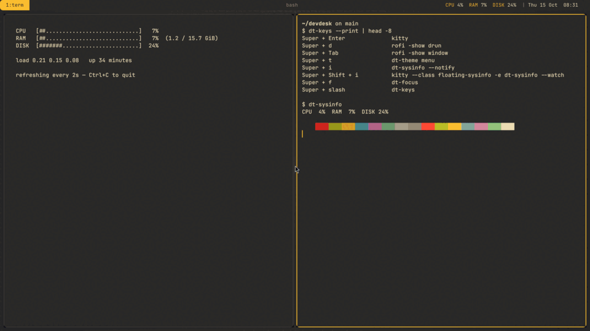
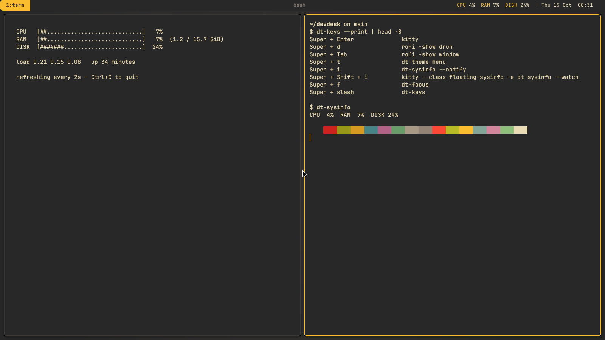
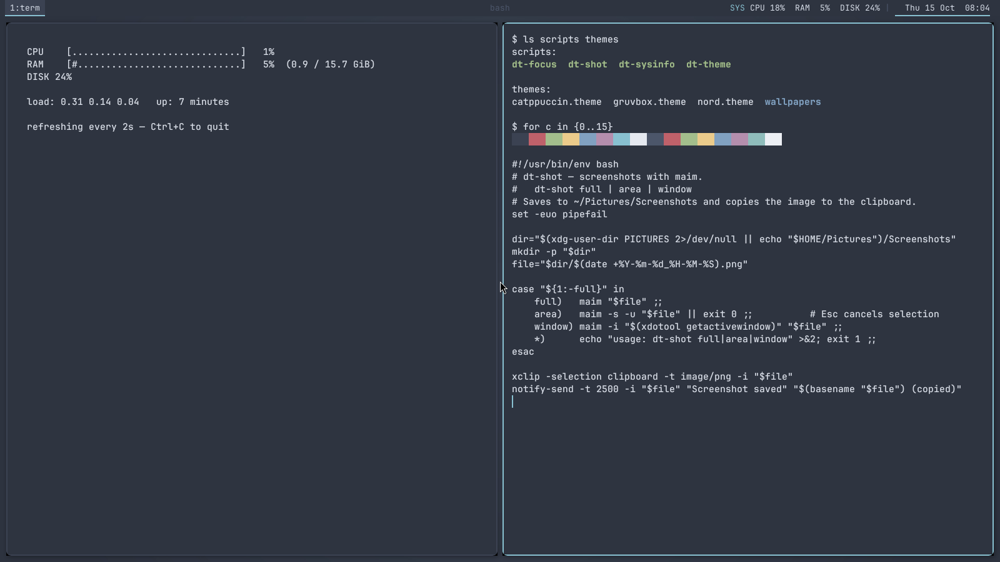
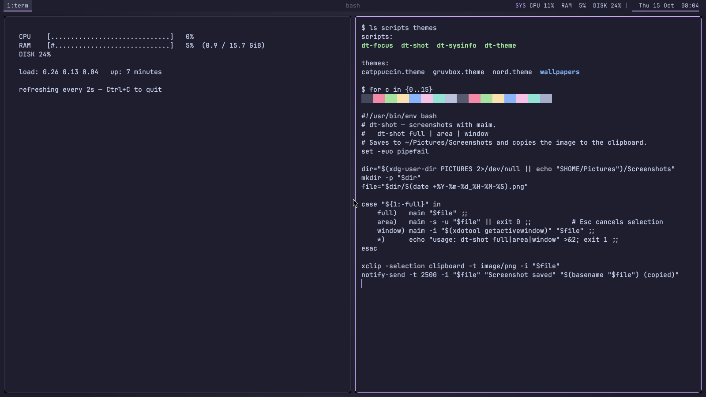
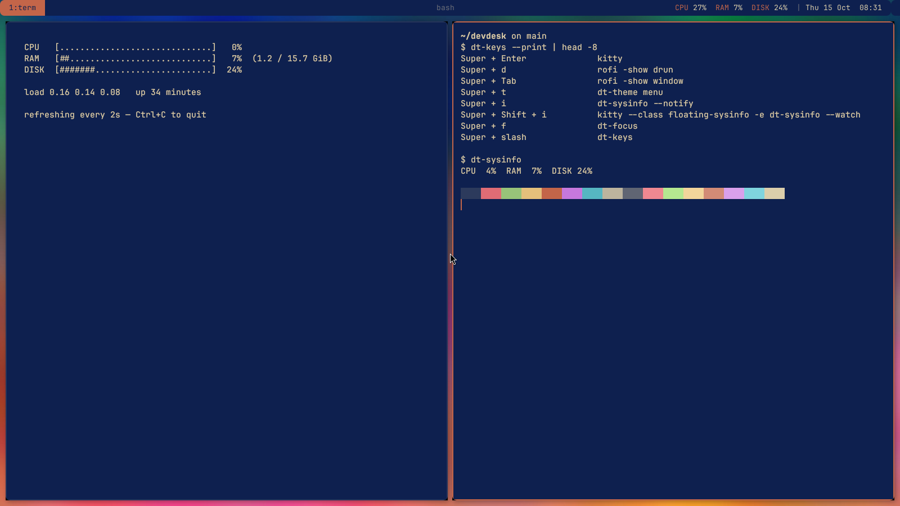
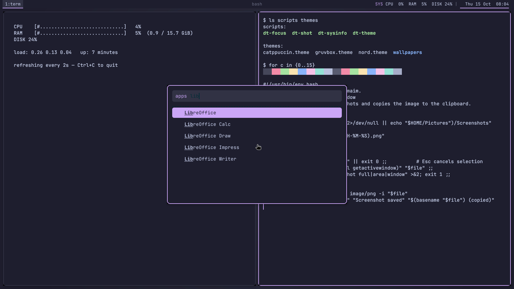
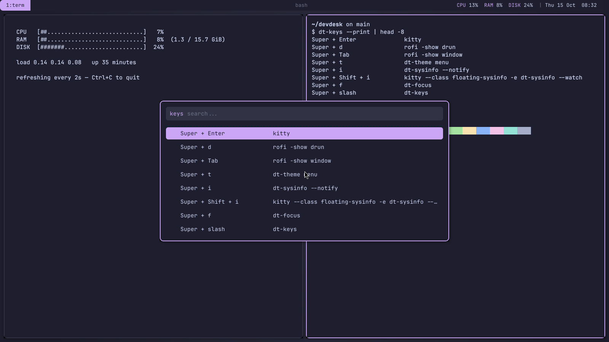
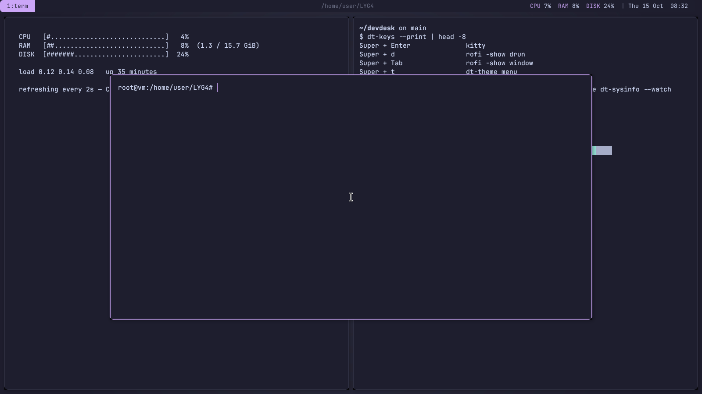
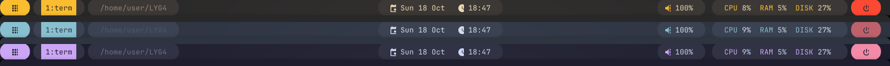

# devdesk — my keyboard-driven i3 setup

[](https://github.com/sharan-sudoaccess/LYG4/actions/workflows/lint.yml)

A small, clean developer desktop built on **i3**. It works on both **Ubuntu** and **Arch Linux**.
Every part of the desktop (terminal, launcher, bar, window borders, notifications, wallpaper)
uses the same colors. One command switches all of them between **3 themes**, or builds a new
theme from **any wallpaper you give it**.



| Gruvbox | Nord | Catppuccin |
|---|---|---|
|  |  |  |

| Theme made from a wallpaper | App launcher |
|---|---|
|  |  |

| Shortcut cheat sheet (`Super+/`) | Drop-down terminal (`Super+-`) |
|---|---|
|  |  |

## What's inside

| Part | Tool | Config |
|---|---|---|
| Window manager | i3 | `config/i3/config` |
| Status bar | polybar (waybar-style pills with icons) | `config/polybar/` |
| Launcher | rofi | `config/rofi/config.rasi` (linked to `~/.config/devdesk/rofi`) |
| Terminal | kitty | `config/kitty/kitty.conf` (linked to `~/.config/devdesk/kitty`) |
| Compositor | picom (shadows, fades, round corners) | `config/picom/picom.conf` |
| Notifications | dunst | `config/dunst/dunstrc.base` |
| Screenshots | maim + xclip | `scripts/dt-shot` |
| Touchpad gestures | libinput-gestures | `config/gestures/libinput-gestures.conf` |
| Wi-Fi / Bluetooth / sound | nmtui, blueman, pavucontrol | opened from the bar |

Everything extra is a short bash script in `scripts/`.

## Install (one command)

```bash
git clone https://github.com/sharan-sudoaccess/LYG4.git ~/devdesk
cd ~/devdesk
./install.sh                 # or: ./install.sh --theme nord
```

`install.sh` will:
1. find out if you're on Arch (`pacman`) or Ubuntu/Debian (`apt`) and install the packages
2. back up any existing configs (`~/.config/i3` → `~/.config/i3.bak.<time>`)
3. symlink the configs into `~/.config` (kitty/rofi into `~/.config/devdesk/`) and the scripts into `~/.local/bin`
4. install the JetBrainsMono Nerd Font (bar icons) and touchpad gestures
5. apply the starting theme

Then log out, choose **i3** on the login screen and log back in. (The first install adds you to
the `input` group for gestures, which only takes effect after that logout.)

### Safe next to your current desktop

devdesk installs **alongside** whatever you already use (GNOME, KDE, or a Hyprland setup such
as JaKooLit's). You just pick the session on the login screen.

- kitty and rofi are shared with many other setups, so devdesk gives them **private configs**
  in `~/.config/devdesk/` and starts them with `--config`. Your `~/.config/kitty` and
  `~/.config/rofi` are never touched.
- `dt-theme` only reloads apps when it's running inside i3, so it never changes a running
  Hyprland or GNOME session.
- Any other config folder that already exists (`i3`, `polybar`, `picom`, `dunst`) is **moved**
  to a `.bak.<time>` folder, never deleted, and `--uninstall` puts it back.

| Option | What it does |
|---|---|
| `--theme <name>` | starting theme (`gruvbox`, `nord`, `catppuccin`) |
| `--no-packages` | only link configs, don't install anything |
| `--uninstall` | remove the links and restore your old configs |

> **Ubuntu note:** use Ubuntu 24.04 or newer. `gaps` only became part of i3 in 4.22, and
> 22.04 ships 4.20. On 22.04, delete the three `gaps`/`smart_gaps` lines in `config/i3/config`.

## Keybindings

`Super` is the mod key. Forgot one? Press **`Super + /`** and search for it.

| Keys | Action |
|---|---|
| `Super + Enter` | terminal (kitty) |
| `Super + -` | drop-down terminal (show/hide) |
| `Super + d` | app launcher (rofi) |
| `Super + Tab` | switch between open windows (rofi) |
| `Super + /` | searchable shortcut cheat sheet |
| `Super + 1..9` | go to workspace |
| `Super + Shift + 1..9` | move window to workspace |
| `Super + [` / `]` | previous / next workspace (creates it if needed) |
| `Super + Shift + [` / `]` | carry the window to the previous / next workspace |
| ``Super + ` `` | jump back to the last workspace |
| `Super + h j k l` (or arrows) | focus window |
| `Super + Shift + h j k l` | move window |
| `Super + b` / `v` | split horizontal / vertical |
| `Super + w` / `s` / `e` | tabbed / stacked / split layout |
| `Super + Shift + f` | fullscreen |
| `Super + Shift + Space` | toggle floating |
| `Super + r` | resize mode (`hjkl`, `Esc` to leave) |
| `Super + q` | close window |
| `Print` | screenshot: full screen |
| `Shift + Print` or `Super + Shift + s` | screenshot: select area |
| `Super + Print` | screenshot: active window |
| `Super + t` | theme picker |
| `Super + i` | system info notification |
| `Super + Shift + i` | live system monitor (floating) |
| `Super + f` | focus mode on/off |
| `Super + Escape` | power menu (lock, logout, suspend, reboot, shutdown) |
| `Super + Shift + x` | lock screen |
| `Super + n` | Wi-Fi menu |
| `Super + Shift + n` | Bluetooth manager |
| `Super + Shift + v` | sound settings |
| volume / brightness keys | volume up/down/mute, screen brightness |
| `Super + Shift + c` / `r` | reload / restart i3 |

Screenshots go to `~/Pictures/Screenshots/` and are also copied to the clipboard.

## Top bar



A waybar-style polybar: each part is a rounded "pill" in the theme's colors, and every pill
can be clicked.

| Pill | Shows | Mouse |
|---|---|---|
| apps icon | | click: app launcher |
| workspaces | `1:term 2:web ...` | click: go there · scroll: switch |
| window title | focused window | |
| date / clock | `Sun 18 Oct 18:47` | click: full date |
| tray | icons of apps like Discord | |
| Wi-Fi | signal + network name | click: Wi-Fi menu |
| Bluetooth | on/off or connected device | click: on/off · right-click: manager |
| volume | icon + % | scroll: volume · click: mute · right-click: mixer |
| brightness | % (laptops only) | scroll: brightness |
| system | `dt-sysinfo`: CPU, RAM, battery | click: popup |
| power | | click: power menu |

Pills hide themselves when there's nothing to show (no Bluetooth, no backlight on a desktop).

## Touchpad gestures

Every gesture simply presses one of the shortcuts above, so gestures and keys always match
(`config/gestures/libinput-gestures.conf`).

| Gesture | Action | Same as |
|---|---|---|
| 3 fingers ← / → | next / previous workspace | `Super + ]` / `[` |
| 3 fingers ↑ | window switcher | `Super + Tab` |
| 3 fingers ↓ | drop-down terminal | `Super + -` |
| 4 fingers ← / → | carry window to next / previous workspace | `Super + Shift + ]` / `[` |
| 4 fingers ↑ | fullscreen on/off | `Super + Shift + f` |
| 4 fingers ↓ | float / tile window | `Super + Shift + Space` |
| 4-finger pinch in | app launcher | `Super + d` |
| 4-finger pinch out | shortcut cheat sheet | `Super + /` |

`dt-touchpad` also sets up the basics when i3 starts: tap to click, two-finger tap for a
right click, three-finger tap for a middle click, two-finger scrolling, natural scrolling and
ignoring the touchpad while you type. Set `NATURAL_SCROLL=0` at the top of the script for classic
scrolling. These settings only apply to the i3 session.

## Scripts

All scripts are plain bash, live in `scripts/` and pass `shellcheck`.

### `dt-theme`: switch theme everywhere

```bash
dt-theme set nord              # gruvbox | nord | catppuccin
dt-theme menu                  # pick one with rofi (Super+t)
dt-theme wall ~/Pictures/x.jpg # make a theme from a wallpaper
dt-theme list
```

Each theme is a short file in `themes/` with a few named colors (`bg`, `fg`, `accent`, ...)
plus the 16 terminal colors. `dt-theme` turns those into small color files for each app:

```
themes/nord.theme ──► ~/.config/i3/theme.conf      (window borders)
                  ├─► ~/.config/kitty/colors.conf  (terminal)
                  ├─► ~/.config/polybar/colors.ini (bar)
                  ├─► ~/.config/rofi/colors.rasi   (launcher)
                  ├─► ~/.config/dunst/dunstrc      (notifications)
                  └─► themes/wallpapers/nord.jpg   (wallpaper)
```

Then it reloads everything that's running: i3, polybar, kitty (with `SIGUSR1`, so open
terminals change color too) and dunst. You don't need to log out.

**Wallpaper themes:** `dt-theme wall <image>` uses ImageMagick to pull the 8 main colors out of
the picture. It takes the darkest one for the background (darkened until text is readable), the
lightest one for text, and the most colorful one for the accent. Then it saves the result as a
normal theme and applies it, so it also shows up in the `Super+t` picker. Try it with
`examples/sunset-wall.jpg`.

**Adding your own theme:** copy `themes/nord.theme`, change the colors, and optionally drop a
wallpaper with the same name into `themes/wallpapers/`.

### `dt-sysinfo`: CPU, RAM, battery

```bash
dt-sysinfo            # CPU 12%  RAM 41%  BAT 87%+
dt-sysinfo --bar      # same, colored for polybar
dt-sysinfo --watch    # live view with bars, refreshes every 2s (--watch 1 for 1s)
dt-sysinfo --notify   # show it as a notification
```

- **CPU** is read from `/proc/stat`
- **RAM** comes from `/proc/meminfo` (`MemTotal - MemAvailable`)
- **Battery** comes from `/sys/class/power_supply/BAT*` (`+` = charging, `=` = full)
- **No battery (desktop)?** It shows CPU temperature instead, and disk usage if there's no sensor.

In the bar, values turn **yellow** at 60% and **red** at 85% (and battery goes red at 15%),
using the colors of the current theme. Click the bar text to get a notification.

**Performance:** measuring CPU needs two readings, so most scripts `sleep` between them.
`dt-sysinfo` saves the last reading in `$XDG_RUNTIME_DIR` instead and compares with the
previous run. That way the bar never waits: each refresh takes about **14 ms instead of
400 ms**.

### `dt-keys`: shortcut cheat sheet

`Super + /` opens every i3 shortcut in a searchable rofi list. It reads your **live i3 config**,
so it's never out of date. Pick a line and press Enter to run that action.

### `dt-shot`: screenshots

`dt-shot full | area | window`. It saves a timestamped PNG, copies it to the clipboard and
shows a notification with a preview.

### `dt-focus`: focus mode

A "do not disturb" switch for deep work. It hides the bar, removes gaps and pauses
notifications. Press it again to turn everything back on, and it tells you how many minutes
you stayed focused.

### `dt-power`: power menu

A small rofi menu for lock, logout, suspend, reboot and shutdown, with a confirmation step for
the risky ones. The lock screen uses the current theme's background color.

## Extras (bonus points)

- **Wallpaper-synced theming:** `dt-theme wall` builds a full theme from any image
- **One-command install** for Arch and Ubuntu, with backup and `--uninstall`
- **Automatic workspace assignment:** browsers open on `2:web`, editors/IDEs on `3:code`,
  chat apps on `4:chat` and media on `5:media`. Dialogs and settings windows float.
- **Faster bar refreshes:** `dt-sysinfo` never sleeps (about 14 ms per refresh), and polybar
  restarts are locked so two theme switches can't fight each other
- **Live reload:** switching themes recolors terminals that are already open
- **My own productivity features:** focus mode, the shortcut cheat sheet and the drop-down terminal
- **Touchpad gestures** for workspaces, windows and launchers, mapped onto the same shortcuts
- **CI:** every push runs `shellcheck` on all scripts and validates the i3 config

## Repo layout

```
.
├── install.sh
├── config/
│   ├── i3/config
│   ├── polybar/{config.ini,launch.sh}
│   ├── rofi/config.rasi
│   ├── kitty/kitty.conf
│   ├── picom/picom.conf
│   ├── dunst/dunstrc.base
│   └── gestures/libinput-gestures.conf
├── scripts/
│   ├── dt-theme     dt-sysinfo   dt-shot     dt-bar
│   ├── dt-keys      dt-focus     dt-power    dt-ws
│   └── dt-touchpad
├── themes/
│   ├── gruvbox.theme  nord.theme  catppuccin.theme
│   └── wallpapers/
├── examples/sunset-wall.jpg
├── screenshots/
└── .github/workflows/lint.yml
```

Generated color files are in `.gitignore`, so the repo only contains the source configs.
